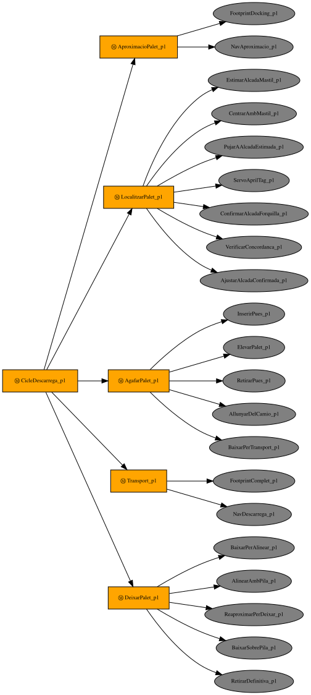

# Simulació d'un AGV carretó elevador — ROS 2 Jazzy + Gazebo Harmonic

[English](README.md) · **Català**

Simulació d'un carretó elevador autònom amb rodes mecanum (AGV/AMR) que
descarrega palets d'un tràiler dins d'un magatzem i els apila en una zona
de descàrrega. Combina SLAM, navegació amb Nav2 i AMCL, detecció i
acoblament als palets amb AprilTag, i un arbre de comportament amb
`py_trees` que encadena tota la missió.

Treball de Fi de Grau (TFG) — Nil, EEBE-UPC.

---

## Índex

- [Funcionalitats](#funcionalitats)
- [Requisits](#requisits)
- [Instal·lació](#installació)
- [Inici ràpid: la missió de descàrrega](#inici-ràpid-la-missió-de-descàrrega)
- [Altres maneres d'executar-ho](#altres-maneres-dexecutar-ho)
- [Arbre de comportament](#arbre-de-comportament)
- [Arquitectura](#arquitectura)
- [Decisions de disseny clau](#decisions-de-disseny-clau)
- [Problemes coneguts](#problemes-coneguts)
- [Limitacions](#limitacions)
- [Estructura del repositori](#estructura-del-repositori)
- [Llicència i crèdits](#llicència-i-crèdits)

---

## Funcionalitats

- **Model del robot** exportat d'Onshape: xassís, 4 rodes mecanum, màstil
  dúplex (màstil mòbil + forquilla amb *free lift*), 2 càmeres i 2 lidars de
  seguretat.
- **Base omnidireccional** amb el `MecanumDrive` de Gazebo i fricció
  anisòtropa a les rodes per simular els rodets a 45°.
- **Control de posició del màstil i la forquilla** amb compensació de
  gravetat: la forquilla arriba a la consigna amb un error de ~0.4 mm, amb
  palet o sense.
- **Percepció de 360°**: dos `gpu_lidar` de 270° en cantonades oposades,
  fusionats en un únic `/scan` amb `dual_laser_merger`.
- **Món del magatzem** amb parets, un envà i columnes asimètrics (perquè
  AMCL no sigui ambigu) i un **tràiler** estàtic (una caixa simplificada) inclòs al món.
- **Palets** (europalet, 0.8 × 1.2 × 0.144 m, 19 kg, dinàmics), cadascun amb
  un AprilTag únic (`tag36h11`, ids 0–9) al costat curt.
- **Mapa SLAM** del magatzem (`slam_toolbox`) i **navegació Nav2** amb AMCL,
  el controlador MPPI (model omnidireccional) i un *footprint* en forma de T
  que inclou les pues.
- **Percepció AprilTag amb dues càmeres**: la del màstil fa una estimació
  grollera de l'alçada i la posició del palet, i la de la forquilla fa
  l'acoblament fi. Les dues estimacions d'alçada han de coincidir; si no,
  el cicle falla en lloc d'aixecar el palet a cegues.
- **Arbre de comportament** (`py_trees` + `py_trees_ros`) organitzat en 5
  fases per palet: aproximació → localització → agafar → transport → deixar
  (a terra o apilat sobre el palet anterior).
- **Teleoperació amb teclat** de la base i de la forquilla.

## Requisits

- Ubuntu 24.04
- ROS 2 Jazzy
- Gazebo Harmonic (s'instal·la amb `ros-jazzy-ros-gz`)
- Les dependències de ROS i Python que hi ha a
  [`agv_description/package.xml`](agv_description/package.xml) (s'instal·len
  amb `rosdep`, vegeu més avall).

**Maquinari:** la missió completa (Gazebo + Nav2 + 2 detectors AprilTag +
l'arbre de comportament) és pesada. S'ha desenvolupat en un Intel
i5-8250U amb 3.7 GB de RAM, on va a un factor de temps real d'entre 0.1 i
0.2, i només la GUI de Gazebo ja consumeix un ~175% de CPU. En una màquina
així, feu servir `headless:=true` sempre que no calgui veure Gazebo. Es
recomana una màquina més potent (vegeu [Problemes
coneguts](#problemes-coneguts)).

## Instal·lació

```bash
# 1. Espai de treball (aquest repositori és la carpeta src/)
mkdir -p ~/agv_ws
git clone https://github.com/nilson6666/agv-forklift-simulation-tfg.git ~/agv_ws/src

# 2. Dependències
sudo apt install python3-rosdep ros-jazzy-ros-gz
sudo rosdep init   # només un cop per màquina
rosdep update
cd ~/agv_ws
rosdep install --from-paths src --ignore-src -r -y

# 3. Compilació
source /opt/ros/jazzy/setup.bash
colcon build --symlink-install
source install/setup.bash
```

> Després d'instal·lar paquets de ROS nous, comproveu que no hagi quedat
> cap paquet actualitzat a mitges: `apt list --upgradable | grep ros-jazzy`
> ha de sortir buit. Durant el desenvolupament, una actualització parcial va
> fer petar AMCL amb `undefined symbol ... fastcdr`; un `sudo apt upgrade`
> complet ho va resoldre.

**No** cal definir `GZ_SIM_RESOURCE_PATH`: el fitxer de launch ja hi afegeix
els models del paquet (tràiler i palet).

## Inici ràpid: la missió de descàrrega

La missió necessita **4 terminals** i un script auxiliar. A cada terminal,
carregueu l'entorn:

```bash
source /opt/ros/jazzy/setup.bash
source ~/agv_ws/install/setup.bash
```

1. **Simulació** — món del magatzem; `slam:=true` treu la transformada
   estàtica `map → odom` perquè la pugui publicar AMCL. Afegiu
   `headless:=true` per executar Gazebo sense la GUI (RViz s'obre igualment).
   ```bash
   ros2 launch agv_description gz_empty.launch.py world:=magatzem.sdf slam:=true
   ```
   El tràiler forma part del món; no cal crear-lo.

2. **Palets** — quan el robot ja és al món, creeu 3 palets sobre el tràiler
   (cadascun amb el seu id de tag):
   ```bash
   ros2 run agv_description spawn_palets.py --count 3
   ```

3. **Navegació** — Nav2 amb AMCL; espereu el missatge `Managed nodes are
   active`. AMCL arrenca localitzat a l'origen, així que no cal fer cap "2D
   Pose Estimate".
   ```bash
   ros2 launch agv_description nav2.launch.py
   ```

4. **AprilTag** — els dos detectors (càmera de la forquilla i del màstil):
   ```bash
   ros2 launch agv_description apriltag.launch.py
   ```

5. **Missió** — l'arbre de comportament:
   ```bash
   ros2 run agv_description pallet_cycle_bt.py --ros-args -p use_sim_time:=true
   ```
   L'arbre s'atura sol quan arriba a `SUCCESS` o `FAILURE` (`Cicle acabat
   amb estat ...` al log).

**Comproveu el resultat a Gazebo, no només al log:**
`gz model -m palet_0 -p` dona la posició real d'un palet.

**Neteja.** `gz sim`, `rviz2`, `parameter_bridge` i
`static_transform_publisher` sovint sobreviuen al Ctrl-C, i les restes d'una
execució anterior (per exemple, un `/clock` duplicat) espatllen la següent.
Abans de tornar a llançar, comproveu-ho i mateu-los pel PID:

```bash
ps -eo pid,args | grep -E "gz sim|rviz2|parameter_bridge|static_transform|nav2_|apriltag_node|pallet_cycle" | grep -v grep
kill -9 <pids>
```

> `apriltag_node` fa un *segfault* en tancar-se. És inofensiu.

## Altres maneres d'executar-ho

### Modes de llançament

| Ús | Ordre |
|---|---|
| Teleoperació, proves de sensors i PID, demos aïllades | `gz_empty.launch.py` (per defecte `slam:=false`: una `map → odom` estàtica permet que RViz mostri el robot sense localització) |
| SLAM o Nav2 | `gz_empty.launch.py slam:=true` (slam_toolbox o AMCL publiquen `map → odom`; dos publicadors es barallarien) |
| Sense la GUI de Gazebo | afegiu `headless:=true` |
| Un altre món | `world:=mon_net.sdf` (món buit, el per defecte) o `world:=magatzem.sdf` |

`slam` només es llegeix en arrencar: per canviar de mode cal reiniciar el
launch.

### Teleoperació amb teclat

```bash
ros2 run agv_description teleop_forklift.py
```

| Tecles | Acció |
|---|---|
| `w` / `x` | endavant / enrere |
| `a` / `d` | lateral esquerra / dreta |
| `q` / `e` | gir esquerra / dreta |
| `s` | aturar la base |
| `r` / `f` | pujar / baixar la forquilla 5 cm |
| `R` / `F` | pujar / baixar la forquilla 25 cm |
| `0` | forquilla a terra |
| `+` / `-` | més ràpid / més lent |

### Alçada de la forquilla per tòpic

`fork_elevator_node.py` converteix una única alçada lògica (0–2.65 m, on
`h = 0` deixa la pua a 3 cm del terra) en les dues consignes dels joints del
màstil dúplex:

```bash
ros2 run agv_description fork_elevator_node.py
ros2 topic pub -r 5 /cmd_fork_global_height std_msgs/msg/Float64 "{data: 1.0}"
```

> Publiqueu amb `-r` uns segons en lloc de `--once`: un sol missatge es pot
> perdre abans que acabi el descobriment DDS.

### Demo del servo visual (`pallet_approach.py`)

S'acosta a un sol palet a terra fent servir només la càmera de la forquilla
i s'atura al *standoff* (2.5 m del centre del robot al tag). No necessita
Nav2.

```bash
# Terminal 1: simulació (robot a l'origen, mirant cap a +x)
ros2 launch agv_description gz_empty.launch.py world:=magatzem.sdf

# Terminal 2: un palet davant del robot, amb el tag de cara
gz service -s /world/magatzem/create --reqtype gz.msgs.EntityFactory \
  --reptype gz.msgs.Boolean --timeout 10000 \
  --req "sdf_filename: \"$(ros2 pkg prefix agv_description)/share/agv_description/models/palet_export/robot.sdf\", pose: {position: {x: 3.6, y: 0.0, z: 0.1}, orientation: {z: 0.7071, w: 0.7071}}, name: \"palet_frontal\""

# Baixar la forquilla (la càmera va muntada al carro de la forquilla)
ros2 topic pub -r 5 /fork_cmd std_msgs/msg/Float64 "{data: -0.15}"   # Ctrl-C al cap d'uns segons

# Terminal 3: detectors i després el servo
ros2 launch agv_description apriltag.launch.py
ros2 run agv_description pallet_approach.py
```

El node mostra `DONE` quan convergeix i després continua publicant
velocitat zero; atureu-lo amb Ctrl-C abans d'executar res més que publiqui
a `/cmd_vel`.

> Aquesta demo es va verificar de cap a cap amb una posició anterior de la
> càmera de la forquilla. Després la càmera es va pujar i inclinar per poder
> apilar (vegeu [Limitacions](#limitacions)) i la demo independent no s'ha
> tornat a provar.

### Mapejar el magatzem (SLAM)

El repositori ja inclou els mapes (`agv_description/maps/`). Per tornar-ne a
fer un:

```bash
ros2 launch agv_description gz_empty.launch.py headless:=true world:=magatzem.sdf slam:=true
ros2 launch slam_toolbox online_async_launch.py \
  slam_params_file:=$(ros2 pkg prefix agv_description)/share/agv_description/params/slam_toolbox.yaml \
  use_sim_time:=true
ros2 run agv_description teleop_forklift.py        # recorreu el magatzem i tanqueu el bucle
ros2 run nav2_map_server map_saver_cli -f el_meu_mapa --ros-args -p use_sim_time:=true
```

> El mapa només hauria de contenir l'edifici. Ara `magatzem.sdf` inclou el
> tràiler, així que per tornar a mapejar cal una còpia del món sense ell.

Mapes del repositori:

| Fitxer | Contingut |
|---|---|
| `magatzem.yaml` | només l'edifici; és el que surt del SLAM |
| `magatzem_raw.yaml` | sortida crua de slam_toolbox, abans del postprocés (falques desconegudes de l'interior convertides en espai lliure) |
| `magatzem_amb_trailer.yaml` | edifici + la caixa de col·lisió del tràiler pintada com a obstacle; **el que carrega Nav2 per defecte** (vegeu les [decisions de disseny](#decisions-de-disseny-clau)) |

### Regenerar els diagrames de l'arbre de comportament

```bash
sudo apt install graphviz python3-pydot
cd ~/agv_ws/src/agv_description
python3 docs/render_bt_diagram.py
```

## Arbre de comportament

Cada palet es gestiona amb un cicle de 5 fases. Cada fase és una
`Sequence`: les seves fulles s'executen en ordre, i si n'hi ha una que falla,
falla tota la missió. L'arbre es construeix amb la mateixa funció que
executa la missió, així que els diagrames sempre coincideixen amb el codi.

**Cicle d'un palet apilat** (el primer palet fa servir una fase
`DeixarPalet` més curta: baixar a terra i retirar-se):



| Fase | Què fa |
|---|---|
| `AproximacioPalet` | redueix el *footprint* de Nav2 al xassís i navega fins a la posició d'aproximació del palet |
| `LocalitzarPalet` | la càmera del màstil estima l'alçada del palet i corregeix x/y/gir; la forquilla puja a aquesta alçada; la càmera de la forquilla fa l'acoblament fi, confirma l'alçada, i les dues estimacions han de coincidir amb menys de 5 cm de diferència |
| `AgafarPalet` | insereix les pues a cegues per odometria, aixeca, recula i baixa a l'alçada de transport |
| `Transport` | recupera el *footprint* complet (amb pues) i navega fins a la zona de descàrrega |
| `DeixarPalet` | primer palet: baixar a terra i retirar-se. Palet apilat: alinear-se amb el tag del palet de sota, avançar per sobre de la pila, baixar fins a 5 mm per sobre i retirar-se |

Diagrames a [`agv_description/docs/`](agv_description/docs/):
`bt_cycle_first.svg` (primer palet), `bt_cycle_stack.svg` (palet apilat) i
`bt_mission.svg` (la missió sencera de 3 palets).

> Els noms de les fulles i els missatges de log són en català. Els
> comentaris del codi són en anglès.

## Arquitectura

### Nodes i tòpics

| Tòpic | Tipus | Qui el publica → qui el fa servir |
|---|---|---|
| `/cmd_vel` | `Twist` | Nav2 / teleop / BT → `MecanumDrive` (Gazebo) |
| `/odom`, `/tf` | `Odometry`, `TFMessage` | `OdometryPublisher` de Gazebo → Nav2, BT |
| `/joint_states` | `JointState` | Gazebo → `robot_state_publisher`, BT |
| `/mast_cmd`, `/fork_cmd` | `Float64` | teleop / BT / `fork_elevator_node` → controladors de posició dels joints |
| `/front_lidar/scan`, `/rear_lidar/scan` | `LaserScan` | Gazebo → `dual_laser_merger` |
| `/scan` | `LaserScan` | `dual_laser_merger` (frame `base_footprint_link`) → AMCL, costmaps, slam_toolbox |
| `/camera_top/image_raw`, `/camera_fork/image_raw` (+ `camera_info`) | `Image` | Gazebo → detectors AprilTag |
| `/apriltag/detections`, `/apriltag/detections_mast` | `AprilTagDetectionArray` | detectors → (depuració); el BT llegeix les posicions dels tags per TF |

Tots els tòpics entre Gazebo i ROS es connecten a
[`params/agv_bridge.yaml`](agv_description/params/agv_bridge.yaml).

### Arbre de TF

```
map ──(AMCL)──▶ odom ──(OdometryPublisher de Gazebo)──▶ base_footprint_link
base_footprint_link ─▶ chassis_link ─▶ fixed_mast_link ─▶ moving_mast_link ─▶ fork_link
                                                                              └─▶ fork_camera_link ─▶ fork_camera_optical_link ─▶ tag36h11:<id>
                                       moving_mast_link ─▶ camera_suport_link ─▶ mast_camera_link ─▶ mast_camera_optical_link ─▶ mast_tag:<id>
                       chassis_link ─▶ 4 × *_wheel_link, front_right_laser_link, rear_left_laser_link
```

- Els frames dels dos lidars es connecten amb transformades estàtiques als
  frames interns que Gazebo escriu als scans
  (`agv_mecanum/base_footprint_link/<sensor>`); gz-sim no permet triar el
  `frame_id` d'un `gpu_lidar`.
- El detector del màstil publica els seus tags com a `mast_tag:<id>` en lloc
  de `tag36h11:<id>`, perquè els dos detectors no publiquin mai el mateix
  frame de TF amb pares diferents.

## Decisions de disseny clau

- **Odometria *ground truth*.** El `MecanumDrive` i l'`OdometryPublisher` de
  Gazebo publicaven tots dos a `/odom` i `/tf`, cosa que provocava una dent
  de serra d'~1° en el gir. L'odometria del `MecanumDrive` es redirigeix a
  `odom_wheels`/`tf_wheels` (sense pont a ROS) i l'`OdometryPublisher`
  (*ground truth*, sense deriva) és l'única font. És equivalent a un AGV
  industrial amb bona odometria.
- **Compensació de gravetat als PID del màstil i la forquilla.** El
  `JointPositionController` de Gazebo no compensa la gravetat i es quedava
  amb un error estacionari igual a pes / guany P (≈7 cm a la forquilla). Un
  `cmd_offset` igual al pes de les parts mòbils (forquilla 329 kg → 3225 N;
  màstil + forquilla → −4115 N, negatiu perquè el seu eix apunta avall) deixa
  al PID només els transitoris. Si canvien les masses a l'URDF, cal tornar a
  calcular els dos *offsets* (vegeu `gazebo_plugins.xacro`).
- **Robot invisible als seus propis lidars.** El pla d'escaneig (z ≈ 0.21 m)
  talla el xassís, les pues i les rodes; totes les visuals del robot queden
  fora del bit de visibilitat 0, que és l'únic que veuen els lidars. Les
  càmeres no se'n veuen afectades.
- ***Footprint* en T, reduït per a l'acoblament.** Les pues sobresurten 1.2
  m per davant del cos, així que Nav2 fa servir un polígon que les inclou.
  Ara bé, a prop del tràiler, qualsevol posició des d'on es pot detectar el
  tag deixa les puntes de les pues dins la zona d'inflació letal. El BT
  canvia a un *footprint* només del xassís per a l'aproximació final i
  recupera el complet per al transport.
- **Tràiler pintat al mapa de Nav2.** `magatzem_amb_trailer.yaml` afegeix
  la caixa del tràiler al mapa del SLAM, perquè el planificador el conegui
  abans que el vegin els lidars. Era imprescindible amb la malla detallada
  del tràiler que es va fer servir durant el desenvolupament: els lidars fan
  *raycast* contra les visuals i, a la seva alçada, només en veien les potes
  i les rodes, no la part frontal sòlida. El tràiler d'aquest repositori és
  una caixa simple, que els lidars sí que veuen com una paret.
- **Percepció de groller a fi amb validació creuada.** Nav2 només deixa el
  robot amb una precisió d'~0.15 m / ~8°, i això ja basta perquè la càmera
  estreta de la forquilla apunti al buit entre dos palets. La càmera ampla
  del màstil corregeix primer la posició i després la de la forquilla fa
  l'acoblament fi. L'alçada de càrrega es calcula a partir de la posició del
  tag que veu cada càmera (`h = tag_z − 0.071`, que centra tot el gruix de
  la pua a la butxaca del palet), i els dos valors han de coincidir.
- **Inserció a cegues.** Per sota d'uns 0.3 m el tag surt del camp de visió
  de la càmera de la forquilla, així que l'últim tram (inserir les pues) es
  fa per odometria, com en un carretó real.

## Problemes coneguts

Aquests problemes estan documentats però **no resolts**: amb el maquinari
disponible no s'hi ha pogut iterar. Les contribucions són benvingudes.

**La missió de 3 palets no s'ha completat mai sencera.** Els palets 0 i 1
(a terra i apilat) s'han completat diverses vegades; el tercer, no.

### 1. AMCL perd la localització al tercer viatge

- **Símptoma:** `NavDescarrega_p2 : navigate_to_pose no ha arribat
  (status=6)`; al log de Nav2, `Resulting plan has 0 poses in it`.
- **Causa (comprovada):** AMCL va saltar a una posició errònia: el robot
  era a (2.14, 2.83, −77°) i AMCL el situava a (13.59, 8.59, +99°), uns 12 m
  i 176° desviat, en una cel·la letal del costmap des d'on no es pot
  planificar cap camí.
- **Encara no se sap:** quan ni per què divergeix. Hipòtesis: (a) la
  sobrecàrrega de CPU (càrrega mitjana ~17) fa que arribin pocs scans a AMCL
  i guanyi una partícula errònia; (b) obstacles que no són al mapa (la pila
  de palets i el palet que es porta travessen el pla d'escaneig) fan que
  l'escaneig no quadri amb el mapa; (c) els paràmetres del model de
  moviment d'AMCL a `nav2.yaml`.
- **Per on començar:** executar-ho sense GUI i registrar la posició d'AMCL
  al costat de la de Gazebo (`gz model -m agv_mecanum -p`) durant la missió.

### 2. En apilar, el palet que es porta pot tapar el tag del palet de sota

- **Símptoma:** `AlinearAmbPila_p1 : timeout global sense convergir`.
- **Causa (comprovada amb una imatge de la càmera de la forquilla):** la
  part de baix del tag del palet de sota queda amagada darrere la vora del
  palet que es porta. El robot s'atura a una distància **fixa** respecte al
  punt de descàrrega teòric, no respecte a on ha quedat realment el palet de
  sota, i la posició final del primer palet varia uns ±15 cm. A l'execució
  fallida, la distància de la base al tag era de 3.73 m en lloc dels 3.91 m
  previstos, i ja era massa a prop.
- **Possibles solucions:** (1) alinear-se primer amb la càmera del màstil,
  que veu per sobre del palet que es porta, i afinar després amb la de la
  forquilla (el mateix patró que a la recollida); (2) un Retry/Fallback a
  l'arbre: si no es veu el tag, recular ~0.3 m i tornar-ho a provar; (3) un
  `place_standoff` més gran, a costa que el tag es vegi més petit.

## Limitacions

- **Només lidars 2D.** El pla d'escaneig (z ≈ 0.21 m) no veu el llit del
  tràiler (1.73 m); la distància entre les pues i el tràiler està garantida
  per geometria, no per sensors. La solució adequada seria un sensor 3D al
  màstil.
- **La càmera de la forquilla veu pitjor de prop.** Es va pujar 0.40 m i
  inclinar 30° perquè pogués veure el palet de sota mentre en porta un
  altre. Com a conseqüència, la detecció a poca distància (0.30–1.25 m entre
  càmera i tag) és pitjor que amb el muntatge baix original. La missió no en
  depèn, perquè el servo visual s'atura a ~1.35 m i la inserció és a cegues.
- **`/scan` calla en espais buits.** `dual_laser_merger` no publica res quan
  el núvol fusionat és buit (cap obstacle a menys de 10 m), cosa que pot
  deixar el costmap sense netejar. Al magatzem sempre hi ha parets a l'abast.
- **Freqüències de sensors baixes.** Lidars a 4 Hz i càmeres a 2 Hz per
  adaptar-se a la màquina de desenvolupament; es poden apujar a
  `gazebo_plugins.xacro` si la vostra màquina ho permet.
- **El tag fix del tràiler (id 10) està desfasat.** Es va col·locar per a
  una versió anterior de la fórmula d'alçada i ara donaria una alçada 3 cm
  massa baixa. La missió actual no el fa servir.
- **Col·lisió del palet simplificada.** El palet fa servir caixes
  primitives per a la col·lisió (coberta, peus i travesser central); la
  malla només és visual.

## Estructura del repositori

```
.
├── LICENSE
├── README.md / README.ca.md
└── agv_description/
    ├── urdf/           robot (xacro): chassis_and_wheels, camera, lidar, plugins i propietats de Gazebo
    ├── assets/         malles del robot (STL, exportades d'Onshape)
    ├── models/
    │   ├── trailer/        tràiler estàtic simplificat: una caixa (amb el tag fix id 10)
    │   └── palet_export/   europalet + textures AprilTag (ids 0–9)
    ├── worlds/         magatzem.sdf (magatzem + tràiler), mon_net.sdf (buit)
    ├── maps/           mapes SLAM (vegeu més amunt)
    ├── launch/         gz_empty (simulació), nav2, apriltag, rviz
    ├── params/         pont, Nav2, slam_toolbox, AprilTag
    ├── scripts/        pallet_cycle_bt (missió), spawn_palets, teleop_forklift,
    │                   fork_elevator_node, pallet_approach
    ├── docs/           diagrames de l'arbre de comportament + render_bt_diagram.py
    └── rviz/           configuració de RViz
```

`rviz.launch.py` mostra només el model del robot a RViz, amb els controls
lliscants de `joint_state_publisher_gui` per moure els joints (sense Gazebo).

## Llicència i crèdits

Publicat sota la [Llicència MIT](LICENSE). Les malles del robot i del palet
són models propis de l'autor.

- **Tràiler:** durant el desenvolupament, la simulació feia servir una
  malla detallada d'un tràiler descarregada de [GrabCAD](https://grabcad.com/).
  **No s'inclou** en aquest repositori, perquè les condicions d'ús de
  GrabCAD no en permeten la redistribució. S'ha substituït per una caixa
  simplificada amb les mateixes dimensions (12.0 × 3.464 × 1.7326 m) que la
  seva col·lisió, que és l'únic amb què interactua la simulació.

- Imatges AprilTag (`tag36_11_*.png`): de
  [AprilRobotics/apriltag-imgs](https://github.com/AprilRobotics/apriltag-imgs)
  (llicència BSD), ampliades ×51 amb filtratge de veí més proper.
- Models exportats amb [onshape-to-robot](https://github.com/Rhoban/onshape-to-robot).
- Fet amb [ROS 2](https://docs.ros.org/en/jazzy/),
  [Gazebo](https://gazebosim.org/), [Nav2](https://nav2.org/),
  [slam_toolbox](https://github.com/SteveMacenski/slam_toolbox),
  [apriltag_ros](https://github.com/christianrauch/apriltag_ros),
  [dual_laser_merger](https://github.com/pradyum/dual_laser_merger) i
  [py_trees](https://github.com/splintered-reality/py_trees).
