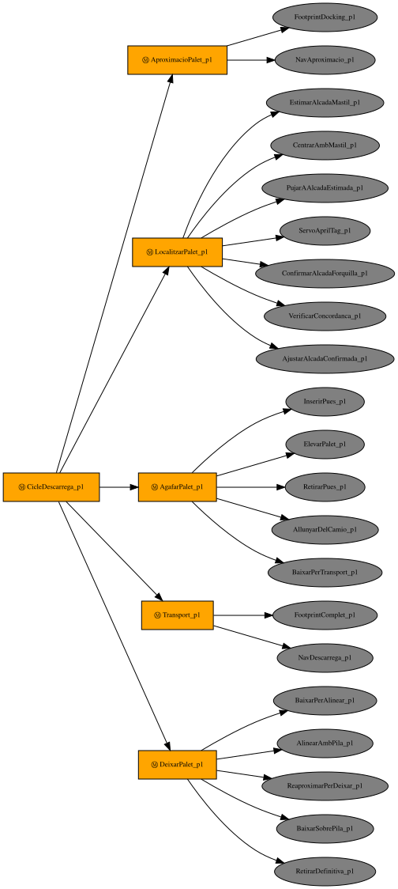

# AGV Forklift Simulation — ROS 2 Jazzy + Gazebo Harmonic

**English** · [Català](README.ca.md)

Simulation of an autonomous mecanum-wheeled forklift (AGV/AMR) that unloads
pallets from a trailer in a warehouse and stacks them in a drop zone. It
combines SLAM, Nav2 navigation with AMCL, AprilTag-based pallet detection
and docking, and a `py_trees` behaviour tree that sequences the whole
mission.

Bachelor's thesis (TFG) — Nil, EEBE-UPC.

---

## Contents

- [Features](#features)
- [Requirements](#requirements)
- [Installation](#installation)
- [Quick start: the unloading mission](#quick-start-the-unloading-mission)
- [Other ways to run it](#other-ways-to-run-it)
- [Behaviour tree](#behaviour-tree)
- [Architecture](#architecture)
- [Key design decisions](#key-design-decisions)
- [Known issues](#known-issues)
- [Limitations](#limitations)
- [Repository layout](#repository-layout)
- [License and credits](#license-and-credits)

---

## Features

- **Robot model** exported from Onshape: chassis, 4 mecanum wheels, duplex
  mast (moving mast + fork with free lift), 2 cameras and 2 safety lidars.
- **Omnidirectional base** with Gazebo's `MecanumDrive` and anisotropic wheel
  friction to simulate 45° rollers.
- **Mast and fork position control** with gravity feed-forward: the fork
  reaches its setpoint within ~0.4 mm, with or without a pallet.
- **360° perception**: two 270° `gpu_lidar` on opposite corners, merged into
  a single `/scan` with `dual_laser_merger`.
- **Warehouse world** with walls, an asymmetric partition and columns (so
  AMCL is not ambiguous), plus a static **trailer** (a simplified box) built into the world.
- **Pallets** (Euro pallet, 0.8 × 1.2 × 0.144 m, 19 kg, dynamic) with a
  unique AprilTag (`tag36h11`, ids 0–9) on the short side.
- **SLAM** (`slam_toolbox`) map of the warehouse and **Nav2** navigation
  with AMCL, the MPPI controller (omni model) and a T-shaped footprint that
  includes the tines.
- **Two-camera AprilTag pipeline**: the mast camera gives a coarse estimate
  of the pallet height and pose, the fork camera does the fine docking. The
  two height estimates must agree, otherwise the cycle fails instead of
  lifting blindly.
- **Behaviour tree** (`py_trees` + `py_trees_ros`) organised in 5 phases per
  pallet: approach → locate → pick up → transport → put down (on the floor or
  stacked on the previous pallet).
- **Keyboard teleop** for the base and the fork.

## Requirements

- Ubuntu 24.04
- ROS 2 Jazzy
- Gazebo Harmonic (installed with `ros-jazzy-ros-gz`)
- Python packages and ROS dependencies listed in
  [`agv_description/package.xml`](agv_description/package.xml) (installed with
  `rosdep`, see below).

**Hardware:** the full mission (Gazebo + Nav2 + 2 AprilTag detectors + the
behaviour tree) is heavy. It was developed on an Intel i5-8250U with 3.7 GB
of RAM, where it runs at a real-time factor of roughly 0.1–0.2 and the
Gazebo GUI alone uses ~175% CPU. On a machine like that, use
`headless:=true` whenever you do not need to watch Gazebo. A more powerful
machine is recommended (see [Known issues](#known-issues)).

## Installation

```bash
# 1. Workspace (this repository is the src/ folder)
mkdir -p ~/agv_ws
git clone https://github.com/nilson6666/agv-forklift-simulation-tfg.git ~/agv_ws/src

# 2. Dependencies
sudo apt install python3-rosdep ros-jazzy-ros-gz
sudo rosdep init   # only once per machine
rosdep update
cd ~/agv_ws
rosdep install --from-paths src --ignore-src -r -y

# 3. Build
source /opt/ros/jazzy/setup.bash
colcon build --symlink-install
source install/setup.bash
```

> After installing new ROS packages, make sure there are no half-upgraded
> packages left: `apt list --upgradable | grep ros-jazzy` should be empty.
> A partial upgrade caused `undefined symbol ... fastcdr` crashes in AMCL
> during development; a full `sudo apt upgrade` fixed it.

You do **not** need to set `GZ_SIM_RESOURCE_PATH`: the launch file adds the
package's models (trailer and pallet) automatically.

## Quick start: the unloading mission

The mission needs **4 terminals** and a helper script. Source the workspace
in every terminal:

```bash
source /opt/ros/jazzy/setup.bash
source ~/agv_ws/install/setup.bash
```

1. **Simulation** — warehouse world; `slam:=true` removes the static
   `map → odom` transform so that AMCL can publish it. Add `headless:=true`
   to run Gazebo without its GUI (RViz still opens).
   ```bash
   ros2 launch agv_description gz_empty.launch.py world:=magatzem.sdf slam:=true
   ```
   The trailer is part of the world; you do not need to spawn it.

2. **Pallets** — once the robot is in the world, spawn 3 pallets on the
   trailer (each one with its own tag id):
   ```bash
   ros2 run agv_description spawn_palets.py --count 3
   ```

3. **Navigation** — Nav2 with AMCL; wait for `Managed nodes are active`.
   AMCL starts localised at the origin, so no "2D Pose Estimate" is needed.
   ```bash
   ros2 launch agv_description nav2.launch.py
   ```

4. **AprilTag** — the two detectors (fork camera and mast camera):
   ```bash
   ros2 launch agv_description apriltag.launch.py
   ```

5. **Mission** — the behaviour tree:
   ```bash
   ros2 run agv_description pallet_cycle_bt.py --ros-args -p use_sim_time:=true
   ```
   The tree stops by itself when it reaches `SUCCESS` or `FAILURE`
   (`Cicle acabat amb estat ...` in the log).

**Check the result in Gazebo, not only in the log:**
`gz model -m palet_0 -p` gives the real pose of a pallet.

**Cleaning up.** `gz sim`, `rviz2`, `parameter_bridge` and
`static_transform_publisher` often survive Ctrl-C, and leftovers from a
previous run (for instance a duplicated `/clock`) break the next one.
Before launching again, check and kill them by PID:

```bash
ps -eo pid,args | grep -E "gz sim|rviz2|parameter_bridge|static_transform|nav2_|apriltag_node|pallet_cycle" | grep -v grep
kill -9 <pids>
```

> `apriltag_node` segfaults when it is shut down. This is harmless.

## Other ways to run it

### Launch modes

| Use | Command |
|---|---|
| Teleop, sensor and PID tests, isolated demos | `gz_empty.launch.py` (default `slam:=false`: a static `map → odom` lets RViz show the robot without localisation) |
| SLAM or Nav2 | `gz_empty.launch.py slam:=true` (slam_toolbox or AMCL publish `map → odom`; two publishers would fight) |
| Without the Gazebo GUI | add `headless:=true` |
| Another world | `world:=mon_net.sdf` (empty world, the default) or `world:=magatzem.sdf` |

`slam` is only read at start-up: switching modes means restarting the launch.

### Keyboard teleop

```bash
ros2 run agv_description teleop_forklift.py
```

| Keys | Action |
|---|---|
| `w` / `x` | forward / backward |
| `a` / `d` | strafe left / right |
| `q` / `e` | turn left / right |
| `s` | stop the base |
| `r` / `f` | raise / lower the fork 5 cm |
| `R` / `F` | raise / lower the fork 25 cm |
| `0` | fork down to the floor |
| `+` / `-` | faster / slower |

### Fork height by topic

`fork_elevator_node.py` converts a single logical height (0–2.65 m, where
`h = 0` leaves the tine 3 cm above the floor) into the two joint commands of
the duplex mast:

```bash
ros2 run agv_description fork_elevator_node.py
ros2 topic pub -r 5 /cmd_fork_global_height std_msgs/msg/Float64 "{data: 1.0}"
```

> Publish with `-r` for a few seconds rather than `--once`: a single message
> can be lost before DDS discovery completes.

### Visual servo demo (`pallet_approach.py`)

Approaches a single pallet on the floor using only the fork camera and
stops at the standoff (2.5 m from the robot centre to the tag). No Nav2
needed.

```bash
# Terminal 1: simulation (robot at the origin, facing +x)
ros2 launch agv_description gz_empty.launch.py world:=magatzem.sdf

# Terminal 2: a pallet in front of the robot, tag facing it
gz service -s /world/magatzem/create --reqtype gz.msgs.EntityFactory \
  --reptype gz.msgs.Boolean --timeout 10000 \
  --req "sdf_filename: \"$(ros2 pkg prefix agv_description)/share/agv_description/models/palet_export/robot.sdf\", pose: {position: {x: 3.6, y: 0.0, z: 0.1}, orientation: {z: 0.7071, w: 0.7071}}, name: \"palet_frontal\""

# Lower the fork (the camera is mounted on the fork carriage)
ros2 topic pub -r 5 /fork_cmd std_msgs/msg/Float64 "{data: -0.15}"   # Ctrl-C after a few seconds

# Terminal 3: detectors, then the servo
ros2 launch agv_description apriltag.launch.py
ros2 run agv_description pallet_approach.py
```

The node prints `DONE` when it converges and then keeps publishing zero
velocity; stop it with Ctrl-C before running anything else that publishes
`/cmd_vel`.

> This demo was verified end to end with an earlier position of the fork
> camera. The camera was later raised and tilted for stacking (see
> [Limitations](#limitations)) and the standalone demo has not been
> re-tested since.

### Mapping the warehouse (SLAM)

The repository already includes the maps (`agv_description/maps/`). To
build one again:

```bash
ros2 launch agv_description gz_empty.launch.py headless:=true world:=magatzem.sdf slam:=true
ros2 launch slam_toolbox online_async_launch.py \
  slam_params_file:=$(ros2 pkg prefix agv_description)/share/agv_description/params/slam_toolbox.yaml \
  use_sim_time:=true
ros2 run agv_description teleop_forklift.py        # drive around and close the loop
ros2 run nav2_map_server map_saver_cli -f my_map --ros-args -p use_sim_time:=true
```

> The map should contain only the building. `magatzem.sdf` now includes the
> trailer, so remapping requires a copy of the world without it.

Maps in the repository:

| File | Content |
|---|---|
| `magatzem.yaml` | building only, used for SLAM |
| `magatzem_raw.yaml` | raw slam_toolbox output, before post-processing (unknown interior wedges turned into free space) |
| `magatzem_amb_trailer.yaml` | building + the trailer collision box painted as an obstacle; **loaded by default by Nav2** (see [design decisions](#key-design-decisions)) |

### Regenerating the behaviour tree diagrams

```bash
sudo apt install graphviz python3-pydot
cd ~/agv_ws/src/agv_description
python3 docs/render_bt_diagram.py
```

## Behaviour tree

Each pallet is handled by one cycle with 5 phases. Every phase is a
`Sequence`: its leaves run in order, and if one fails the whole mission
fails. The tree is built from the same function the mission runs, so the
diagrams always match the code.

**Cycle of a stacked pallet** (the first pallet uses a shorter `DeixarPalet`
phase: lower to the floor and withdraw):



| Phase | What it does |
|---|---|
| `AproximacioPalet` | reduces the Nav2 footprint to the chassis and navigates to the pallet's approach pose |
| `LocalitzarPalet` | the mast camera estimates the pallet height and corrects x/y/yaw; the fork rises to that height; the fork camera docks precisely, confirms the height, and both estimates must agree within 5 cm |
| `AgafarPalet` | inserts the tines blindly by odometry, lifts, backs out and lowers to transport height |
| `Transport` | restores the full footprint (with tines) and navigates to the drop zone |
| `DeixarPalet` | first pallet: lower to the floor and withdraw. Stacked pallet: align with the tag of the pallet below, drive over the stack, lower to 5 mm above it and withdraw |

Diagrams in [`agv_description/docs/`](agv_description/docs/):
`bt_cycle_first.svg` (first pallet), `bt_cycle_stack.svg` (stacked pallet)
and `bt_mission.svg` (the whole 3-pallet mission).

> The leaf names and log messages are in Catalan (e.g. `InserirPues` =
> insert tines, `ElevarPalet` = lift pallet). The code comments are in
> English.

## Architecture

### Nodes and topics

| Topic | Type | Publisher → user |
|---|---|---|
| `/cmd_vel` | `Twist` | Nav2 / teleop / BT → `MecanumDrive` (Gazebo) |
| `/odom`, `/tf` | `Odometry`, `TFMessage` | Gazebo `OdometryPublisher` → Nav2, BT |
| `/joint_states` | `JointState` | Gazebo → `robot_state_publisher`, BT |
| `/mast_cmd`, `/fork_cmd` | `Float64` | teleop / BT / `fork_elevator_node` → joint position controllers |
| `/front_lidar/scan`, `/rear_lidar/scan` | `LaserScan` | Gazebo → `dual_laser_merger` |
| `/scan` | `LaserScan` | `dual_laser_merger` (frame `base_footprint_link`) → AMCL, costmaps, slam_toolbox |
| `/camera_top/image_raw`, `/camera_fork/image_raw` (+ `camera_info`) | `Image` | Gazebo → AprilTag detectors |
| `/apriltag/detections`, `/apriltag/detections_mast` | `AprilTagDetectionArray` | detectors → (debug); the BT reads the tag poses from TF |

All Gazebo ↔ ROS topics are bridged in
[`params/agv_bridge.yaml`](agv_description/params/agv_bridge.yaml).

### TF tree

```
map ──(AMCL)──▶ odom ──(Gazebo OdometryPublisher)──▶ base_footprint_link
base_footprint_link ─▶ chassis_link ─▶ fixed_mast_link ─▶ moving_mast_link ─▶ fork_link
                                                                              └─▶ fork_camera_link ─▶ fork_camera_optical_link ─▶ tag36h11:<id>
                                       moving_mast_link ─▶ camera_suport_link ─▶ mast_camera_link ─▶ mast_camera_optical_link ─▶ mast_tag:<id>
                       chassis_link ─▶ 4 × *_wheel_link, front_right_laser_link, rear_left_laser_link
```

- The two lidar frames are bridged with static transforms to the internal
  frames Gazebo writes in the scans (`agv_mecanum/base_footprint_link/<sensor>`);
  gz-sim does not allow choosing the `frame_id` of a `gpu_lidar`.
- The mast detector publishes its tags as `mast_tag:<id>` instead of
  `tag36h11:<id>`, so the two detectors never publish the same TF frame with
  different parents.

## Key design decisions

- **Ground-truth odometry.** Gazebo's `MecanumDrive` and the
  `OdometryPublisher` both published `/odom` and `/tf`, which produced a
  sawtooth of ~1° in yaw. The `MecanumDrive` odometry is redirected to
  `odom_wheels`/`tf_wheels` (not bridged), and the `OdometryPublisher`
  (ground truth, zero drift) is the only source. This is equivalent to an
  industrial AGV with good odometry.
- **Gravity feed-forward on the mast and fork PIDs.** Gazebo's
  `JointPositionController` does not compensate gravity and got stuck with a
  steady-state error of weight / P-gain (≈7 cm on the fork). A `cmd_offset`
  equal to the weight of the moving parts (fork 329 kg → 3225 N; mast + fork
  → −4115 N, negative because its axis points down) leaves the PID only the
  transients. If the masses in the URDF change, both offsets must be
  recomputed (see `gazebo_plugins.xacro`).
- **Robot invisible to its own lidars.** The scan plane (z ≈ 0.21 m) crosses
  the chassis, tines and wheels; all robot visuals are outside visibility
  bit 0, which is the only bit the lidars see. The cameras are not affected.
- **T-shaped footprint, reduced for docking.** The tines stick out 1.2 m in
  front of the body, so Nav2 uses a polygon that includes them. Near the
  trailer, however, any pose from which the tag can be detected puts the
  tine tips inside the lethal inflation zone. The BT switches to a
  chassis-only footprint for the final approach and restores the full one
  for transport.
- **Trailer painted on the Nav2 map.** `magatzem_amb_trailer.yaml` adds the
  trailer's box to the SLAM map, so the planner knows about it before the
  lidars see it.
- **Coarse-to-fine perception with cross-validation.** Nav2 only gets the
  robot within ~0.15 m / ~8°, which is enough to point the narrow fork
  camera at the gap between two pallets. The wide mast camera corrects the
  pose first; then the fork camera docks precisely. The load height is
  computed from each camera's tag pose (`h = tag_z − 0.071`, centring the
  whole tine thickness in the pallet pocket), and both values must agree.
- **Blind insertion.** Below ~0.3 m the tag leaves the fork camera's field
  of view, so the last stretch (inserting the tines) is done by odometry, as
  on a real forklift.

## Known issues

These issues are documented but **not fixed**: with the available hardware
it was not possible to iterate on them. Contributions are welcome.

**The 3-pallet mission has never completed in full.** Pallets 0 and 1
(on the floor and stacked) have been completed several times; the third
one has not.

### 1. AMCL loses its localisation on the third trip

- **Symptom:** `NavDescarrega_p2 : navigate_to_pose no ha arribat
  (status=6)`; in the Nav2 log, `Resulting plan has 0 poses in it`.
- **Cause (verified):** AMCL jumped to a wrong pose: robot actually at
  (2.14, 2.83, −77°), AMCL at (13.59, 8.59, +99°), about 12 m and 176°
  off, in a lethal costmap cell from which no path can be planned.
- **Not yet known:** when and why it diverges. Hypotheses: (a) CPU overload
  (load average ~17) means few scans reach AMCL and a wrong particle wins;
  (b) obstacles that are not on the map — the stack of pallets and the
  carried pallet both cross the scan plane — make the scan disagree with
  the map; (c) the AMCL motion model parameters in `nav2.yaml`.
- **Suggested starting point:** run headless and log the AMCL pose next to
  the Gazebo pose (`gz model -m agv_mecanum -p`) during the mission.

### 2. When stacking, the carried pallet can hide the tag of the pallet below

- **Symptom:** `AlinearAmbPila_p1 : timeout global sense convergir`.
- **Cause (verified with a fork camera frame):** the bottom of the lower
  pallet's tag is hidden behind the far edge of the carried pallet. The
  robot stops at a **fixed** distance from the theoretical drop pose, not
  from where the pallet below actually is, and the first pallet's final
  position varies by about ±15 cm. In the failed run the base-to-tag
  distance was 3.73 m instead of the designed 3.91 m, and that was already
  too close.
- **Possible fixes:** (1) align first with the mast camera, which sees over
  the carried pallet, then refine with the fork camera (the same pattern as
  the pick-up); (2) a Retry/Fallback in the BT: if the tag is not seen,
  back up ~0.3 m and try again; (3) a larger `place_standoff`, at the cost
  of a smaller tag in the image.

## Limitations

- **2D lidars only.** The scan plane (z ≈ 0.21 m) does not see the trailer
  bed (1.73 m); the clearance between the tines and the trailer is
  guaranteed by geometry, not sensed. A 3D sensor on the mast would be the
  proper solution.
- **The fork camera sees worse up close.** It was raised 0.40 m and tilted
  30° so that it can see the pallet below while carrying another one. As a
  consequence, detection at short range (0.30–1.25 m camera-to-tag) is
  worse than with the original low mount. The mission does not depend on
  it, because the visual servo stops at ~1.35 m and the insertion is blind.
- **`/scan` goes silent in empty spaces.** `dual_laser_merger` publishes
  nothing when the merged cloud is empty (no obstacle within 10 m), which
  can starve the costmap clearing. In the warehouse there are always walls
  in range.
- **Low sensor rates.** Lidars at 4 Hz and cameras at 2 Hz to fit the
  development machine; raise them in `gazebo_plugins.xacro` if your machine
  allows it.
- **The trailer's fixed tag (id 10) is out of date.** It was placed for an
  earlier version of the height formula and would now give a height 3 cm
  too low. The current mission does not use it.
- **Simplified pallet collision.** The pallet uses primitive boxes for
  collision (deck, feet and central stringer); the mesh is only visual.

## Repository layout

```
.
├── LICENSE
├── README.md / README.ca.md
└── agv_description/
    ├── urdf/           robot (xacro): chassis_and_wheels, camera, lidar, Gazebo plugins and properties
    ├── assets/         robot meshes (STL, exported from Onshape)
    ├── models/
    │   ├── trailer/        simplified static trailer: one box (with the fixed tag id 10)
    │   └── palet_export/   Euro pallet + AprilTag textures (ids 0–9)
    ├── worlds/         magatzem.sdf (warehouse + trailer), mon_net.sdf (empty)
    ├── maps/           SLAM maps (see above)
    ├── launch/         gz_empty (simulation), nav2, apriltag, rviz
    ├── params/         bridge, Nav2, slam_toolbox, AprilTag
    ├── scripts/        pallet_cycle_bt (mission), spawn_palets, teleop_forklift,
    │                   fork_elevator_node, pallet_approach
    ├── docs/           behaviour tree diagrams + render_bt_diagram.py
    └── rviz/           RViz configuration
```

`rviz.launch.py` shows the robot model alone in RViz, with
`joint_state_publisher_gui` sliders to move the joints (no Gazebo).

## License and credits

Released under the [MIT License](LICENSE). The robot and pallet meshes are
the author's own models.

- AprilTag images (`tag36_11_*.png`): from
  [AprilRobotics/apriltag-imgs](https://github.com/AprilRobotics/apriltag-imgs)
  (BSD license), upscaled ×51 with nearest-neighbour filtering.
- Models exported with [onshape-to-robot](https://github.com/Rhoban/onshape-to-robot).
- Built on [ROS 2](https://docs.ros.org/en/jazzy/),
  [Gazebo](https://gazebosim.org/), [Nav2](https://nav2.org/),
  [slam_toolbox](https://github.com/SteveMacenski/slam_toolbox),
  [apriltag_ros](https://github.com/christianrauch/apriltag_ros),
  [dual_laser_merger](https://github.com/pradyum/dual_laser_merger) and
  [py_trees](https://github.com/splintered-reality/py_trees).
